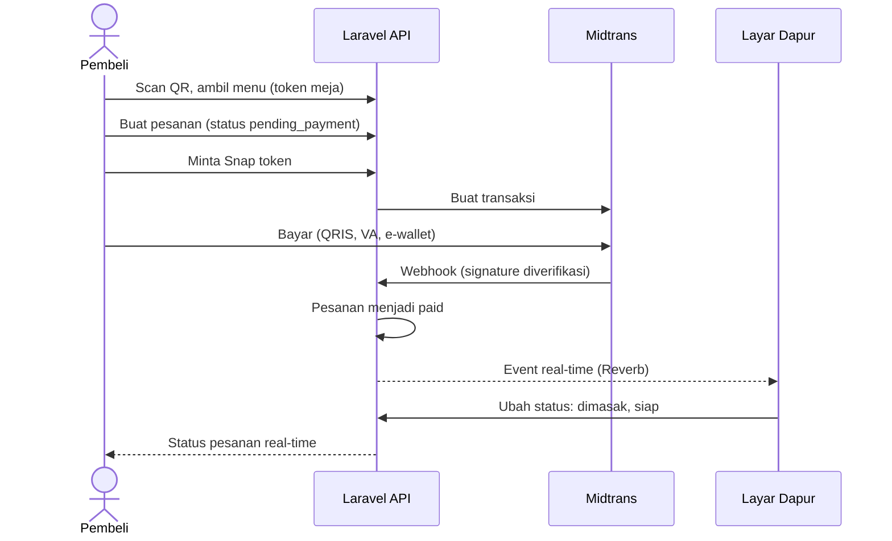

# Self-Order QR Menu API


Backend sistem pemesanan mandiri untuk restoran: pembeli scan QR code di meja, memilih menu dari HP, membayar lewat Midtrans, dan pesanan langsung muncul secara real-time di layar dapur, tanpa pelayan dan tanpa refresh halaman.

Proyek portofolio yang dibangun fitur demi fitur dengan alur Git branch dan pull request. Frontend (React) dibangun di repositori terpisah.

## Fitur

- **QR per meja**: token unik tiap meja, QR dapat diunduh sebagai SVG, token bisa dibuat ulang jika QR bocor
- **Menu publik tanpa login**: menu dikelompokkan per kategori, hanya menu yang tersedia
- **Pemesanan aman**: harga dan total dihitung ulang di server, seluruh pesanan disimpan dalam satu transaksi database, nama dan harga menu disimpan sebagai snapshot
- **Pembayaran Midtrans Snap**: webhook diverifikasi signature (SHA512), nominal dicocokkan, notifikasi duplikat aman (idempotent)
- **Real-time dengan Laravel Reverb**: pesanan yang sudah dibayar langsung masuk ke dapur, perubahan status langsung sampai ke pembeli
- **Alur status pesanan ketat**: `paid → preparing → ready → completed`, dibatasi per role (dapur, kasir, admin), aman terhadap klik bersamaan
- **Role dan autentikasi**: Laravel Sanctum (token), role admin, kasir, dapur
- **Test otomatis dan CI**: feature test termasuk satu alur end-to-end, dijalankan GitHub Actions di setiap PR

## Teknologi

Laravel, PHP 8.2+, MySQL, Laravel Sanctum, Laravel Reverb (WebSocket), Midtrans Snap, endroid/qr-code, PHPUnit, GitHub Actions.

## Alur sistem



## Instalasi

Kebutuhan: PHP 8.2+, Composer, MySQL.

```bash
git clone https://github.com/USERNAME/self-order-api.git
cd self-order-api
composer install
cp .env.example .env
php artisan key:generate
```

Buat database MySQL (misalnya `self_order`), lalu atur `.env`:

```env
DB_CONNECTION=mysql
DB_DATABASE=self_order
DB_USERNAME=root
DB_PASSWORD=

FRONTEND_URL=http://localhost:5173

MIDTRANS_SERVER_KEY=      # dari dashboard Midtrans Sandbox
MIDTRANS_CLIENT_KEY=
MIDTRANS_IS_PRODUCTION=false
```

Jalankan migrasi dan seeder data demo:

```bash
php artisan migrate --seed
php artisan storage:link
```

### Akun demo (hanya untuk development)

| Role  | Email             | Password |
|-------|-------------------|----------|
| Admin | admin@example.com | password |
| Kasir | kasir@example.com | password |
| Dapur | dapur@example.com | password |

Seeder juga membuat 3 kategori, 9 menu (satu sengaja tidak tersedia), dan 10 meja. **Jangan menjalankan seeder ini di production**, dan ganti semua password demo.

## Menjalankan

Buka tiga terminal:

```bash
php artisan serve                  # API di http://localhost:8000
php artisan reverb:start --debug   # server WebSocket
php artisan queue:listen           # worker antrean (event broadcast)
```

## Dokumentasi API

Dokumentasi interaktif (Swagger UI) tersedia di `http://localhost:8000/docs/index.html`.
Spesifikasinya ada di [`public/docs/openapi.yaml`](public/docs/openapi.yaml) dan bisa diimpor ke Postman (Import, pilih file).

Ringkasan endpoint:

| Area | Endpoint | Akses |
|------|----------|-------|
| Auth | `POST /api/auth/login`, `POST /api/auth/logout`, `GET /api/auth/me` | Login: publik, lainnya: token |
| Admin | `/api/admin/categories`, `/api/admin/menus`, `/api/admin/dining-tables` (+ `regenerate-token`, `qr`) | Admin |
| Pelanggan | `GET /api/public/tables/{token}/menu` | Publik |
| Pelanggan | `POST /api/public/tables/{token}/orders` | Publik |
| Pelanggan | `GET /api/public/tables/{token}/orders/{code}` | Publik |
| Pelanggan | `POST /api/public/tables/{token}/orders/{code}/pay` | Publik |
| Staf | `GET /api/staff/orders`, `PATCH /api/staff/orders/{id}/status` | Admin, kasir, dapur (aturan per role) |
| Webhook | `POST /api/webhooks/midtrans` | Midtrans (verifikasi signature) |

## Event real-time

| Channel | Event | Isi | Pendengar |
|---------|-------|-----|-----------|
| `private-staff.orders` | `order.paid` | Pesanan lengkap | Dapur, kasir |
| `private-staff.orders` | `order.updated` | Pesanan lengkap setelah status berubah | Dapur, kasir |
| `orders.{kode}` (publik) | `order.status-updated` | Kode pesanan dan status | Pembeli |

Channel privat memakai Bearer token Sanctum lewat `POST /api/broadcasting/auth`. Channel pembeli bersifat publik karena pembeli tidak punya akun. Kode pesanan acak dan payload hanya berisi kode serta status, dan frontend tetap mengambil data dari endpoint status pesanan.

## Menguji pembayaran secara lokal

1. Buat pesanan dan minta Snap token, lalu buka `redirect_url` dan bayar lewat Midtrans Payment Simulator.
2. Agar webhook sampai ke komputer Anda, buat URL publik sementara (ngrok atau cloudflared) dan daftarkan `https://URL-ANDA/api/webhooks/midtrans` sebagai Payment Notification URL di dashboard Sandbox.

## Testing

```bash
php artisan test
./vendor/bin/pint --test   # cek gaya kode
```

Test mencakup autentikasi, CRUD admin, menu publik, pembuatan pesanan, pembayaran dan webhook, event real-time, alur status, seeder, dan satu alur end-to-end dari scan QR sampai pesanan selesai.

## Catatan keamanan dan desain

- Harga tidak pernah dipercaya dari client, selalu dihitung ulang dari database.
- Status pesanan hanya berubah lewat webhook yang signature-nya valid, bukan callback browser.
- Row lock (`lockForUpdate`) mencegah pembayaran ganda dan loncatan status akibat request bersamaan.
- Rate limit pada login dan pembuatan pesanan; respons 404 generik agar token meja tidak bisa ditebak.
- Menu, meja, dan pesanan dengan riwayat tidak dihapus permanen, cukup dinonaktifkan.

## Rencana berikutnya

- Frontend React (halaman pembeli dan layar dapur)
- Deploy (VPS atau layanan gratis)
- Pembatalan dan refund pesanan
- Laporan penjualan 


